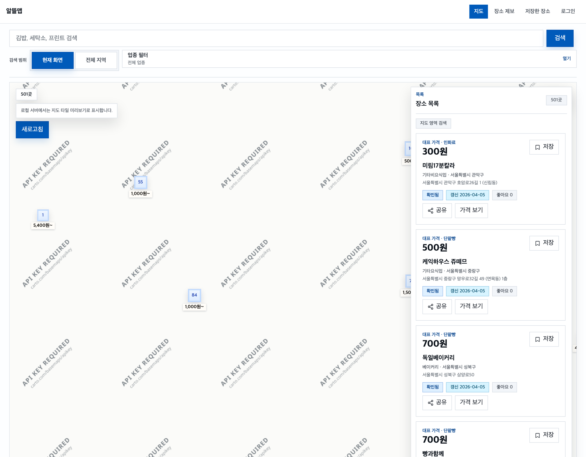
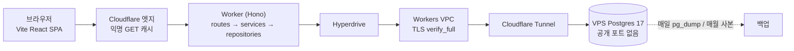
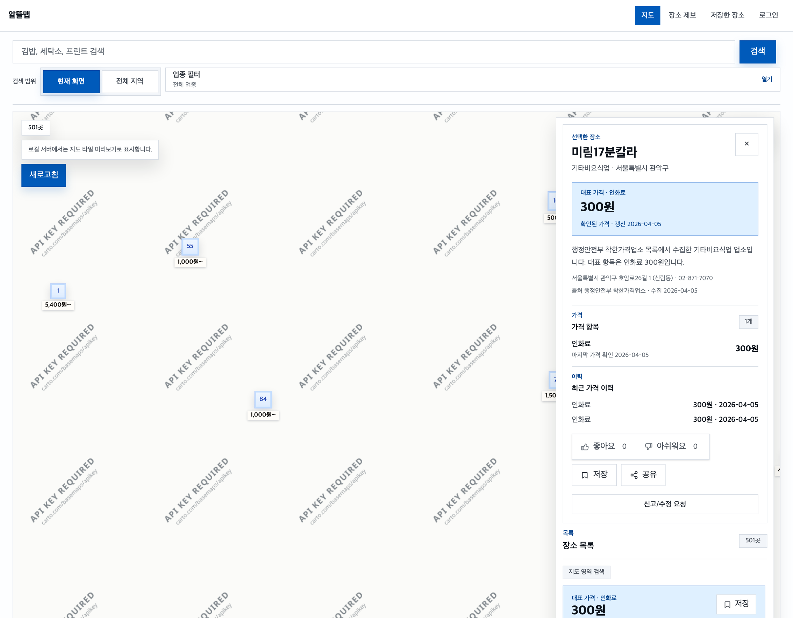
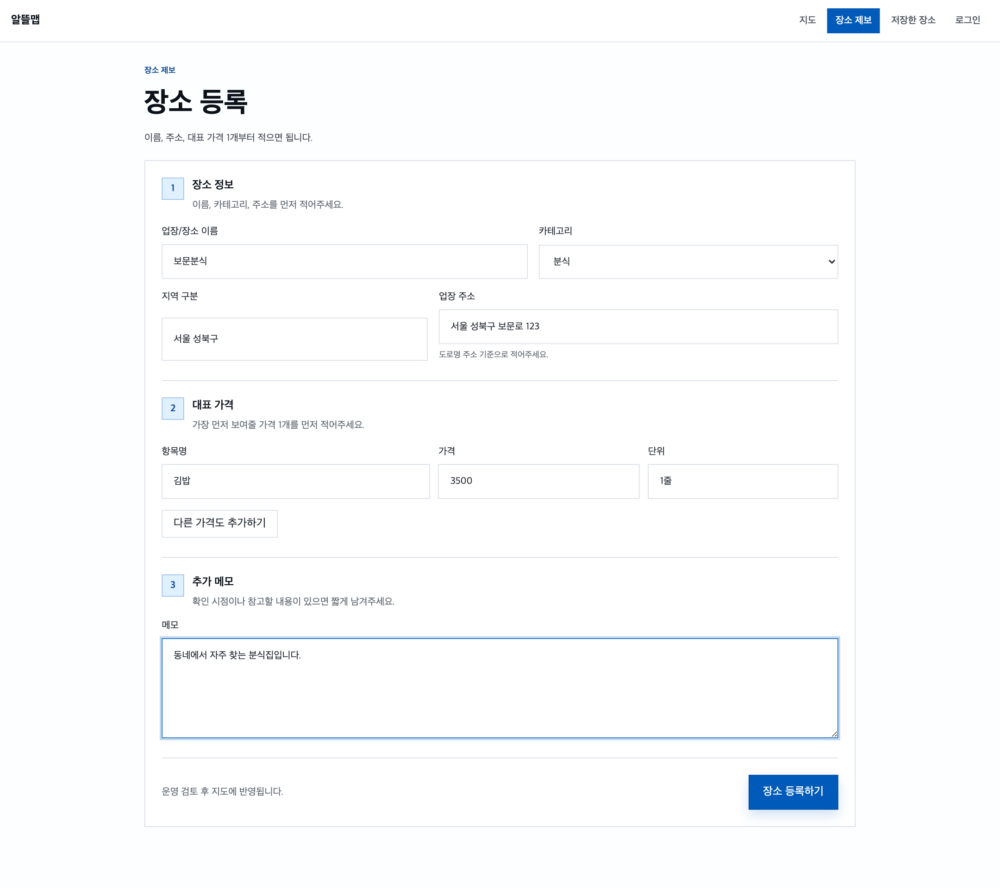
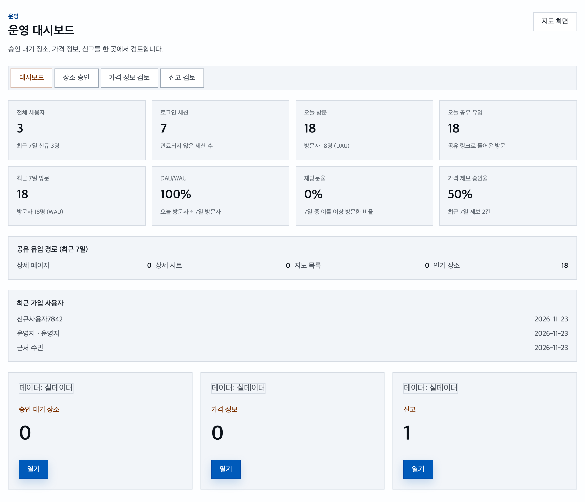

# 알뜰맵 (Altteulmap)

> 동네의 저렴한 식당과 생활 서비스를 지도에서 찾고, 가격을 제보하고, 운영자가 검수하는 서비스


- 데모: [altteulmap.altteul-lab.workers.dev](https://altteulmap.altteul-lab.workers.dev) · 관리자: [/admin](https://altteulmap.altteul-lab.workers.dev/admin)
- 문서: [문서 안내](docs/문서-안내.md) · [ADR](docs/adr/README.md) · [운영 지연 측정](docs/06-성능/결과/2026-11-24-한국-측정.md)

행정안전부 `착한가격업소` 공공데이터 1,000곳을 정제해 넣고, 누구나 장소·가격·신고를 제보하면 운영자가 검수해 반영합니다. 혼자 설계·개발·배포·운영하는 백엔드 중심 프로젝트이며, 실제 운영 DB를 직접 운영합니다.



## 아키텍처



- 공개 앱·관리자·API를 Cloudflare Worker 하나로 제공합니다.
- 운영 DB는 직접 관리하는 VPS의 전용 Postgres입니다. DB 포트를 인터넷에 열지 않고 Tunnel과 Workers VPC로만 접속하며, Worker는 DML만 가능한 role을 씁니다.
- Worker 내부는 `routes`(HTTP·인증·rate limit) → `services`(도메인 규칙, `DomainError`) → repository(Drizzle 쿼리) 계층입니다. 자세한 흐름은 [아키텍처 개요](docs/02-설계/아키텍처-개요.md)에 있습니다.

## 설계 결정

| 문제 | 선택 | 근거 |
| --- | --- | --- |
| 서명 쿠키 세션은 로그아웃·강등 후에도 만료까지 유효 | DB 세션: 쿠키에는 랜덤 토큰, DB에는 SHA-256 해시만 저장, 7일 고정 만료 | [ADR 0001](docs/adr/0001-database-sessions.md) |
| 익명 쓰기는 쿠키를 버리면 rate limit이 초기화됨 | Postgres 원자 upsert 카운터 + IP 버킷 + 로그인 계정 버킷 | [ADR 0002](docs/adr/0002-rate-limit-in-postgres.md) |
| 운영자 동시 승인 시 상태·검증 판정 경합 | advisory lock + 조건부 `UPDATE ... RETURNING`, 제보 멱등 키 | [ADR 0003](docs/adr/0003-price-moderation-locking.md) |
| Workers isolate는 연결을 공유할 수 없음 | 요청 컨텍스트당 연결 1개, timeout, circuit breaker | [ADR 0004](docs/adr/0004-request-scoped-db-connection.md) |
| 관리자 대기열 페이지네이션 | offset(규모상 충분, 재평가 조건 명시) | [ADR 0005](docs/adr/0005-offset-pagination-for-admin-queue.md) |
| Supabase를 그만 쓰고 DB를 직접 운영 | VPS Postgres + Tunnel + Workers VPC + Hyperdrive | [ADR 0006](docs/adr/0006-vps-postgres-via-tunnel-and-hyperdrive.md) |
| 7개 컬럼 부분 문자열 검색 | `ILIKE` + pg_trgm GIN 부분 인덱스 | [ADR 0007](docs/adr/0007-trigram-index-for-search.md) |

모든 실패 응답은 `{ ok:false, message, error:{ code, details? }, requestId }` 하나로 통일했습니다([API 계약](docs/02-설계/API-계약-지도.md)).

## 측정과 개선

DB를 오스트리아 VPS로 옮기자 한국 기준 장소 상세가 1.6초가 됐습니다. `Server-Timing`으로 DB 구간을 분리해 보니 쿼리 1개 왕복이 약 0.4초였고, 비용이 쿼리 **개수**에 비례했습니다. 병렬화는 효과가 없었습니다(Hyperdrive 경유에서는 한 연결의 쿼리가 순차 처리됨). 그래서 쿼리 수를 줄였습니다.

| 요청 (한국, p95) | 개선 전 | 개선 후 | 한 일 |
| --- | --- | --- | --- |
| 장소 상세 | 1,632ms | 618ms | 쿼리 5개 → 상관 서브쿼리 JSON 집계 1개 |
| 지도 zoom 15 | 1,144ms | 652ms | 건수+행 2개 → `count(*) over ()` 1개 |
| 지도 zoom 11 (캐시 미스) | 1,727ms | 1,177ms | 행 500건 → SQL 클러스터 격자 집계, 응답 442KB → 139KB |
| 지도 첫 화면 (캐시 적중) | - | 약 200ms | 익명 GET 엣지 캐시(지도 60초, 상세 20초) |

zoom 11 캐시 미스는 아직 목표(1초)를 넘습니다. 측정 환경·표본·남은 병목은 [운영 지연 측정](docs/06-성능/결과/2026-11-24-한국-측정.md)에 있습니다.

## 검증

| 단계 | 내용 | 명령 |
| --- | --- | --- |
| unit 55개 | 순수 도메인 규칙, HTTP·rate limit 계약 | `npm run verify` (lint + typecheck + unit) |
| integration 31개 | 실제 Postgres: 권한 경계, 실패 경로, 가격 제보 생명주기·동시 승인, rate limit 우회, SQL 클러스터 = JS 클러스터 | `npm run test:integration:local` |
| E2E 30개 | Playwright 데스크톱 Chromium, 실제 DB와 mock 모드 | `npm run test:e2e:full` |
| 운영 smoke | 6시간마다 운영 URL에 관리자 로그인·세션 폐기까지 확인, 12시간마다 deep health | `npm run smoke:remote` |
| 품질 게이트 | dead code, CSP inline style 목록, 문서 링크·경로 검사 | `npm run verify:quality` |

GitHub Actions가 push마다 위 단계와 migration drift 검사, `npm audit`(high)를 실행합니다.

## 운영

- 배포: `npm run deploy`(Node 22) → `smoke:remote`. migration은 SSH 터널로 배포 전에 적용합니다([배포 가이드](docs/deploy/deploy-cloudflare.md)).
- 백업: VPS에서 매일 `pg_dump`(14일) → 개발 머신으로 매월 사본(`npm run backup:pull`). 덤프를 임시 DB에 복원해 운영과 행 수가 같은지 확인했습니다([백업·복구](docs/09-운영-가이드/백업-복구.md)).
- 정기 작업: Worker cron이 매시간 만료 세션과 rate limit 버킷을 정리합니다.

## 한계

- DB가 단일 VPS라 이중화·PITR이 없고, RPO는 최대 24시간입니다. 원격 스토리지 백업과 새 서버 복구 리허설은 아직 하지 않았습니다.
- 실제 사용자 트래픽이 없고, 부하 처리량(k6)은 측정하지 않았습니다.
- Kakao/Naver OAuth는 redirect·state·callback 거부까지만 자동 검증하고, 실제 계정 로그인은 미검증입니다.
- 관리자 화면의 검수 제안 패널은 저장된 제안을 검증해 보여 주는 경계까지이며, 제안을 생성하는 외부 AI 연동은 없습니다.

## 화면

| 상세 시트 | 제보 | 관리자 |
| --- | --- | --- |
|  |  |  |

## 로컬 실행

```bash
cp .dev.vars.example .dev.vars
npm run db:local:setup   # Docker Postgres 기동, migration, seed
npm run dev              # http://localhost:5173, 관리자 /admin
```

- Worker가 읽는 값(DB·인증)은 `.dev.vars` 하나에 둡니다. `DATABASE_URL`이 비어 있으면 지도 API가 503입니다.
- DB 없이 UI만 보려면 `USE_MOCK_DATA=true npm run dev`.
- 중지는 `npm run db:local:down`, volume까지 초기화는 `CONFIRM_RESET=1 npm run db:local:reset`.

## 스택

Vite 8 · React 19 · Tailwind CSS 4 · Cloudflare Workers · Hono · Hyperdrive · PostgreSQL 17 · Drizzle ORM · NAVER Maps · Playwright
